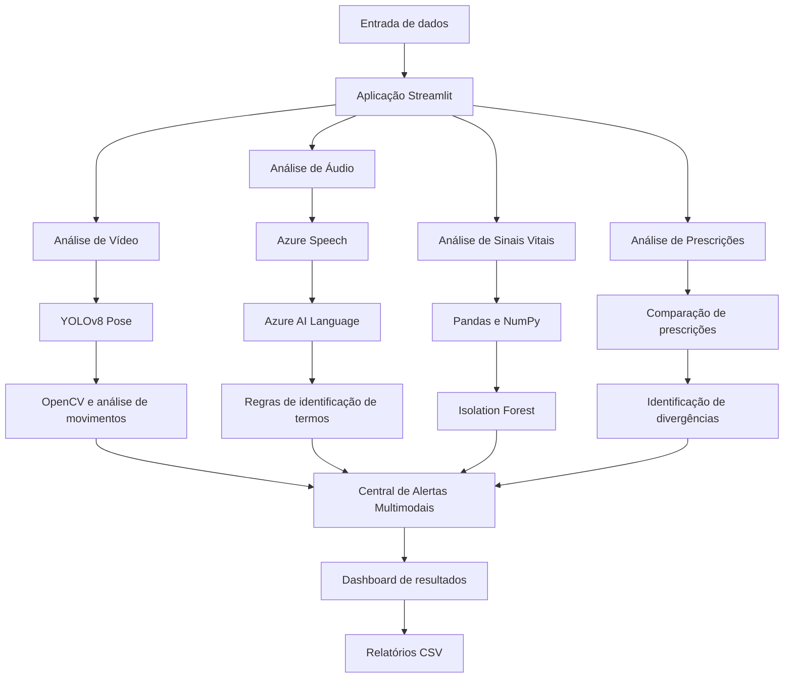

# Arquitetura Técnica — MedMonitor AI

## 1. Visão geral

O MedMonitor AI utiliza uma arquitetura modular desenvolvida em Python, com foco no processamento independente de diferentes fontes de informação e na consolidação de resultados por meio de uma Central de Alertas Multimodais.

A solução foi estruturada para demonstrar a aplicação de inteligência artificial, visão computacional, processamento de linguagem natural e algoritmos de detecção de anomalias em um cenário simulado de monitoramento hospitalar.

A aplicação utiliza Streamlit como interface principal, enquanto os módulos Python concentram as responsabilidades de processamento e análise.

## 2. Diagrama de arquitetura

## 3. Camadas da arquitetura

### 3.1. Camada de apresentação

Responsável pela interação com o usuário, recebimento de arquivos, execução das análises e apresentação dos resultados.

Tecnologia principal: Streamlit.

Funcionalidades:
- Navegação entre módulos.
- Upload de arquivos de áudio e vídeo.
- Visualização de indicadores.
- Exibição de gráficos e tabelas.
- Consulta da Central de Alertas.
- Exportação de relatórios CSV.

### 3.2. Camada de processamento

Contém os módulos independentes responsáveis pelo tratamento e análise dos dados.

**Módulo de vídeo — `video_analysis.py`**

Utiliza YOLOv8 Pose para estimar pontos-chave corporais e OpenCV para processamento dos frames.

O processamento permite:
- Identificar pessoas nos frames.
- Estimar posições articulares.
- Calcular ângulos dos joelhos.
- Identificar repetições de movimentos.
- Comparar a amplitude das repetições.
- Gerar vídeos anotados e relatórios CSV.

**Módulo de áudio — `audio_analysis.py`**

Utiliza o Azure Speech Services para realizar a transcrição de arquivos de áudio em português brasileiro.

O módulo recebe arquivos de áudio e retorna o texto reconhecido e informações sobre o resultado da transcrição.

**Módulo de análise textual — `text_analysis.py`**

Utiliza Azure AI Language para processamento da transcrição.

Funcionalidades:
- Análise de sentimento.
- Extração de frases-chave.
- Reconhecimento de entidades.
- Identificação de informações relevantes no texto.

**Módulo de alertas clínicos — `clinical_alerts.py`**

Implementa um mecanismo de regras para identificar expressões relacionadas a categorias de atenção, como:
- Respiratória.
- Cardíaca.
- Neurológica.
- Geral.
- Visual.
- Gastrointestinal.

As categorias e prioridades são experimentais e definidas por regras de texto.

**Módulo de sinais vitais — `vital_signs.py`**

Utiliza Pandas, NumPy e Scikit-learn para processar séries temporais.

O algoritmo Isolation Forest é utilizado para identificar observações estatisticamente atípicas considerando:
- Frequência cardíaca.
- Pressão arterial sistólica.
- Pressão arterial diastólica.
- Saturação de oxigênio.

Para a demonstração, são gerados dados sintéticos com alterações artificiais controladas.

**Módulo de prescrições — `prescription_analysis.py`**

Realiza a comparação entre prescrições simuladas e registros de administração.

Identifica:
- Medicamentos não administrados.
- Doses divergentes.
- Atrasos de administração.
- Registros sem prescrição correspondente.

### 3.3. Camada de consolidação

O módulo `multimodal_alerts.py` recebe os resultados armazenados na sessão da aplicação e consolida as ocorrências identificadas.

As informações são organizadas considerando:
- Origem da ocorrência.
- Categoria.
- Prioridade experimental.
- Descrição.

A central permite visualizar os resultados de diferentes módulos em uma única interface e exportar as ocorrências em CSV.

### 3.4. Camada de armazenamento e saída

Na versão atual, os resultados são mantidos principalmente em memória por meio do `st.session_state` do Streamlit durante a sessão de utilização.

Os relatórios gerados podem ser exportados em formato CSV.

Os arquivos processados e relatórios podem ser organizados nas pastas `outputs/processed_videos` e `outputs/reports`.

A versão atual não implementa banco de dados persistente para histórico de pacientes ou ocorrências.

## 4. Tecnologias e justificativas

| Tecnologia | Justificativa |
|---|---|
| Python | Integração dos módulos e processamento |
| Streamlit | Desenvolvimento rápido da interface |
| YOLOv8 Pose | Estimativa de poses corporais |
| OpenCV | Manipulação e análise de vídeos |
| Azure Speech | Conversão de áudio em texto |
| Azure AI Language | Análise de linguagem natural |
| Scikit-learn | Aplicação de algoritmos de aprendizado de máquina |
| Isolation Forest | Detecção de observações atípicas |
| Pandas | Organização e análise de dados |
| NumPy | Operações numéricas |

## 5. Fluxo de processamento multimodal

O processamento ocorre de maneira independente em cada módulo.

1. O usuário fornece um arquivo ou inicia uma análise com dados simulados.
2. O módulo correspondente executa seu processamento.
3. São extraídas informações e identificados padrões atípicos.
4. Os resultados são armazenados na sessão da aplicação.
5. A Central de Alertas consulta os resultados disponíveis.
6. As ocorrências são consolidadas e disponibilizadas para visualização e exportação.

Essa organização permite evoluir cada módulo sem exigir a reestruturação completa da aplicação.

## 6. Segurança e limitações

O protótipo foi desenvolvido exclusivamente para fins acadêmicos e demonstrativos.

As credenciais dos serviços Azure são armazenadas em variáveis de ambiente, utilizando o arquivo `.env`, que não deve ser versionado no repositório.

As principais limitações da versão atual são:

- Utilização de dados sintéticos em parte das demonstrações.
- Ausência de persistência de histórico em banco de dados.
- Dependência de conectividade para serviços Azure.
- Critérios experimentais para identificação de discrepâncias de movimento.
- Regras textuais que podem não interpretar corretamente negações e contexto.
- Detecção estatística que não representa classificação de risco clínico.
- Comparação de prescrições sem integração com sistemas hospitalares reais.

A utilização em ambiente clínico exigiria validação técnica e especializada, avaliação de segurança, privacidade, desempenho e conformidade regulatória.

## 7. Evolução futura

Entre as possibilidades de evolução estão:

- Implementação de persistência de dados.
- Integração com sistemas hospitalares.
- Aprimoramento da fusão multimodal.
- Desenvolvimento de mecanismos de análise contextual.
- Melhoria dos critérios de classificação de ocorrências.
- Avaliação com conjuntos de dados reais e autorizados.
- Implementação de auditoria e rastreabilidade dos alertas.

## 8. Considerações finais

A arquitetura do MedMonitor AI demonstra como diferentes tecnologias de inteligência artificial podem ser integradas em uma aplicação modular para monitoramento multimodal.

A separação das responsabilidades facilita a manutenção, os testes e a evolução dos componentes, enquanto a Central de Alertas oferece uma visão consolidada dos resultados produzidos pelos diferentes módulos.

**Projeto acadêmico — FIAP Tech Challenge Fase 4.**